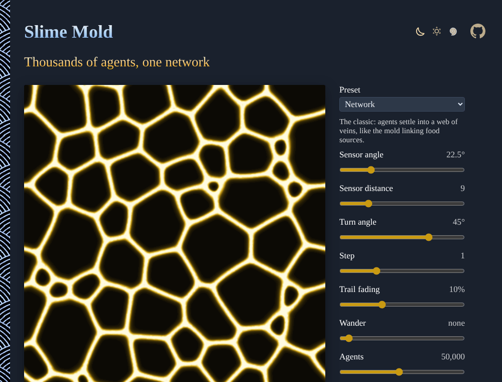

# Slime-Mold

Thousands of agents follow each other's scent and grow the vein networks of the slime mold *Physarum polycephalum*, live in the browser. Tune their senses, lay food with your finger, and download the picture. No sign-up, no libraries.

**[▶ Grow a network](https://evoluteur.github.io/slime-mold/)**

## Features

| Control | What it does |
| ------- | ------------ |
| **Preset** | Network, Long veins, Lace, Cells, Worms, Bubbles, or Foam. |
| **Sensor angle** | How far to the left and right each agent sniffs. |
| **Sensor distance** | How far ahead it sniffs. |
| **Turn angle** | How sharply it turns toward the scent (negative: away from it). |
| **Step** | How far it moves each tick. |
| **Trail fading** | How fast the scent fades. |
| **Wander** | A random wobble of the heading. |
| **Agents** | From 5,000 to 100,000. |
| **Start** | Scattered, a disk, a ring, or a burst from the center. |
| **Colors** | Slime yellow, Bioluminescent, Gold on black, Ember, Ink on paper, Violet. |
| **Download PNG** | The picture, 512 × 512. |

Drag on the picture to lay food: the agents gather to it and the network reroutes. The address of the page keeps the settings, to share them.

## How it is built

After Jeff Jones' model (2010). Each agent has a position and a heading. At every tick it:

1. **Senses** the scent on a trail map at three points ahead: straight on, to the left and to the right.
2. **Turns** toward the strongest scent (or at random when straight on is the weakest).
3. **Moves** one step, wrapping around the edges, and **deposits** scent where it lands.

Then the scent **diffuses** (a 3 × 3 blur) and **fades**. A cell holds at most a little scent, so no single vein takes over and the network keeps its many veins.

Plain HTML, CSS and JavaScript, with no dependencies and no build step:

| File | Content |
| ---- | ------- |
| [index.html](index.html) | the page and its controls |
| [js/slime.js](js/slime.js) | the agents, the trail map and the drawing |
| [css/slime.css](css/slime.css) | the styles of the page |
| [css/themes](css/themes) | the three color themes |

To run it locally, just open `index.html` in a browser. The three color themes (dark, light and blue) are shared with my other projects (copied from [omg-themes](https://github.com/evoluteur/omg-themes)).

## A little history

In 2010, researchers in Japan placed oat flakes on a map of the cities around Tokyo and let the slime mold grow: it linked them with a network of veins as efficient as the real rail lines (Tero et al., *Rules for Biologically Inspired Adaptive Network Design*, Science, 2010). The same year Jeff Jones showed how such networks emerge from simple agents (*Characteristics of pattern formation and evolution in approximations of Physarum transport networks*, Artificial Life, 2010).

## Related projects

- [Flow Fields](https://evoluteur.github.io/flow-fields/) ([code](https://github.com/evoluteur/flow-fields))
- [Reaction-Diffusion](https://evoluteur.github.io/reaction-diffusion/) ([code](https://github.com/evoluteur/reaction-diffusion))
- [Lightning and Coral](https://evoluteur.github.io/lightning-and-coral/) ([code](https://github.com/evoluteur/lightning-and-coral))

For more patterns grown from a few rules, see [Generative Art](https://evoluteur.github.io/generative-art.html).

## License

Slime Mold is open source under the [MIT license](LICENSE).

Had fun with the app? [Buy me a coffee by becoming a sponsor](https://github.com/sponsors/evoluteur).

(c) 2026 [Olivier Giulieri](https://evoluteur.github.io/)
